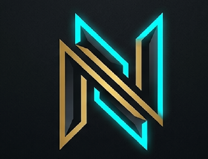

# Nylarion Studios — Play Beyond Reality

Nylarion Studios is an independent game development studio creating immersive games and innovative digital experiences.

> **Play Beyond Reality.**



---

## 🌟 Description

Nylarion Studios is an indie game studio focused on developing high-quality, memorable titles across Mobile, PC, and emerging platforms. Guided by creativity, quality, and technical innovation, we craft interactive experiences that inspire players and shape the future of digital entertainment.

---

## ✨ Features

- **Interactive 3D Emblem**: Real-time canvas pixel background cutout engine delivering 100% color-accurate sRGB graphics with interactive mouse and touch controls powered by Three.js.
- **Cyber Grid Atmosphere**: Deep Midnight Navy background system (`#080a15`) with full-page grid patterns and 280 ambient floating cyan and gold color particles.
- **Authentic Indie Brand Messaging**: Honest, transparent storytelling highlighting mission, vision, core values, and upcoming debut titles.
- **Production-Ready & Lightweight**: Zero external build dependencies, optimized loading performance, modular CSS/JS architecture, and instant Vercel deployment capability.

---

## 📁 Folder Structure

```
Nylarion-Studios/
│
├── index.html                  # Clean semantic HTML5 web page
├── README.md                   # Comprehensive project architecture guide
├── LICENSE                     # MIT License
├── .gitignore                  # Git untracked OS & IDE files filter
│
├── assets/
│   ├── images/
│   │   ├── logo.png            # High-resolution brand logo mark
│   │   └── favicon.ico         # Website browser tab favicon
│   │
│   ├── models/                 # Future .glb 3D asset files
│   └── videos/                 # Future video trailer assets
│
├── css/
│   └── styles.css              # Modular CSS design system & responsive rules
│
└── js/
    └── main.js                 # Three.js 3D Emblem engine, particles & interactivity
```

---

## 🛠️ Technologies Used

- **HTML5**: Semantic web architecture
- **CSS3**: Custom CSS variables, Grid, Flexbox, Keyframe Animations, Glassmorphism
- **JavaScript (ES6+)**: Modular client-side rendering & interaction logic
- **Three.js (r128)**: 3D WebGL Web Canvas engine, particle physics, sRGB color management
- **Responsive Design**: Mobile-first media queries supporting screens from 320px up to 4K

---

## 🚀 How to Run

Because Nylarion Studios is built with native web standards, no `npm install` or compilation step is required!

1. Clone or download the repository:
   ```bash
   git clone https://github.com/sreecharantomail-arch/Nylarion-studios.git
   cd Nylarion-studios
   ```
2. Open `index.html` directly in any web browser, or launch using a local server (e.g. VS Code Live Server or Python HTTP server):
   ```bash
   python -m http.server 8000
   ```
3. Navigate to `http://localhost:8000`.

---

## ☁️ Deployment

This repository is pre-configured for instant static hosting on **Vercel**, **GitHub Pages**, or **Netlify**.

### Deploying to Vercel:
1. Connect your GitHub account to [Vercel](https://vercel.com).
2. Import the `Nylarion-studios` repository.
3. Keep default settings (Framework Preset: *Other*) and click **Deploy**.

---

## 🗺️ Future Roadmap

- 🎮 **Games**: Official announcements and launch pages for debut Mobile & PC titles.
- 📱 **Apps**: Companion mobile utility apps and developer tools.
- 🖼️ **Gallery**: High-resolution concept art gallery and interactive media showcases.
- 📰 **News**: Developer logs, studio updates, and patch notes.
- 🧊 **3D Models**: WebGL interactive `.glb` model viewers for in-game assets.

---

## 👤 Author

**Nylarion Studios**
- Website: [Nylarion Studios](https://github.com/sreecharantomail-arch/Nylarion-studios)
- Email: [nylarionstudios@gmail.com](mailto:nylarionstudios@gmail.com)

---

© 2026 **Nylarion Studios**. All Rights Reserved.
